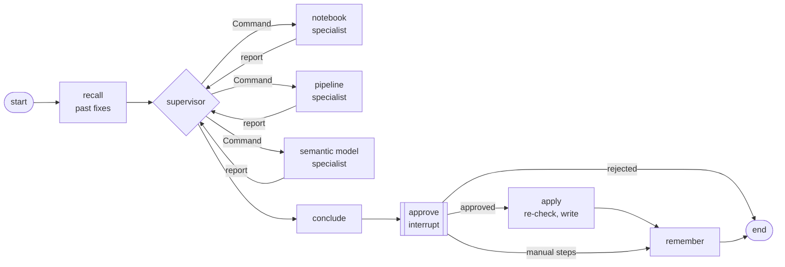

# LangGraph triage lab

Learn LangGraph end to end by rebuilding one real thing: an agent that finds failed jobs
in a Microsoft Fabric workspace, works out why they failed, proposes a fix, waits for a
human to approve it, and applies it.

Twelve lessons. Each one adds one LangGraph capability to the same problem, so by
lesson 12 you have a production-shaped agent and you know why every piece is there.



## Quick start (no Azure needed)

```bash
python -m venv .venv
source .venv/bin/activate          # Windows: .venv\Scripts\activate
pip install -e ".[dev]"
cp .env.example .env               # leave FABRIC_MODE=fake and MODEL_MODE=fake

python -m lessons.l01_state_graph  # then l02, l03 ... in order
python -m triage_lab.agent demo    # the finished agent, whole loop
pytest                             # every lesson + the agent, all offline
```

In fake mode the Fabric workspace is built into the code (a notebook reading a table that
doesn't exist, the pipeline that runs it, and a semantic model with bad credentials), and
the model is a scripted stand-in. Everything runs offline, free and the same every time.

## Using your real workspace and Azure OpenAI

Edit `.env`:

```bash
FABRIC_MODE=real
FABRIC_WORKSPACE_IDS=<workspace guid>
FABRIC_TENANT_ID=...      # or leave the three SP values empty to use `az login`
FABRIC_CLIENT_ID=...
FABRIC_CLIENT_SECRET=...

MODEL_MODE=azure
AZURE_OPENAI_ENDPOINT=https://<resource>.openai.azure.com
AZURE_OPENAI_DEPLOYMENT=<deployment name>
AZURE_OPENAI_API_KEY=     # empty = Entra ID via DefaultAzureCredential
```

What each identity needs:

| Call | Permission |
| --- | --- |
| List items, job history, read definitions | Service principal (or you) as a member of the workspace; tenant setting "Service principals can use Fabric APIs" on |
| List lakehouse tables (OneLake) | Read access to the lakehouse |
| Write a fix (`updateDefinition`) | Contributor on the workspace, plus `FABRIC_WRITES_ENABLED=true` and the workspace in `FABRIC_WRITE_WORKSPACE_IDS`. Off by default; use a dev workspace |
| Model with Entra auth | `Cognitive Services OpenAI User` on the Azure OpenAI / Foundry resource |

Never commit `.env`. It is git-ignored. Workspace IDs, tenant IDs and secrets only ever
live there.

## The lessons

| # | File | Capability |
| --- | --- | --- |
| 1 | `l01_state_graph` | State, nodes, edges, compile, stream values |
| 2 | `l02_reducers_and_routing` | Reducers, parallel branches, conditional edges |
| 3 | `l03_structured_output` | First model call, Pydantic structured output, batch |
| 4 | `l04_tools_and_agent_loop` | Tools, ToolNode, the ReAct loop, recursion limit |
| 5 | `l05_context_retries_errors` | Runtime context, retry policies, error handlers |
| 6 | `l06_checkpoints_time_travel` | Checkpointer, threads, history, forking |
| 7 | `l07_human_approval` | `interrupt()` and `Command(resume=...)` |
| 8 | `l08_send_and_subgraphs` | `Send` map-reduce, subgraphs, tools that update state |
| 9 | `l09_supervisor_command` | Multi-agent supervisor with `Command` handoffs |
| 10 | `l10_store_memory` | Long-term memory with the Store |
| 11 | `l11_streaming` | updates / messages / custom streams, subgraph events |
| 12 | `l12_triage_agent` | All of it, with a proper system of record |

Each lesson file starts with a guide: what you learn, what to watch when you run it, the
one-paragraph interview answer, and things to try. `lessons/README.md` collects them.

## Layout

```
triage_lab/
  settings.py      one place for configuration (.env)
  contracts.py     the few shared data shapes (Failure, Definition, Patch, CaseEntry)
  fabric.py        Fabric: one interface, a real REST client, a fake workspace
  models.py        Azure OpenAI in Foundry, or the scripted fake model
  texts.py         how facts are written out for the model
  checkpoints.py   checkpointers with a serializer that knows our types
  team.py          specialist tools and the investigator subgraph   (lessons 4, 5, 8)
  supervisor.py    supervisor + specialists with Command            (lesson 9)
  agent/           the finished agent                               (lesson 12)
    graph.py       the graph
    store.py       incidents, plans, actions (SQLite)
    service.py     keeps the graph and the records in step
    cli.py         python -m triage_lab.agent ...
lessons/           l01 ... l12, runnable, each with its guide
tests/             offline tests for every lesson, the agent and the real client
```

Versions this was written against: LangGraph 1.2, langchain-core 1.7, langchain-openai 1.7,
Python 3.11+.
